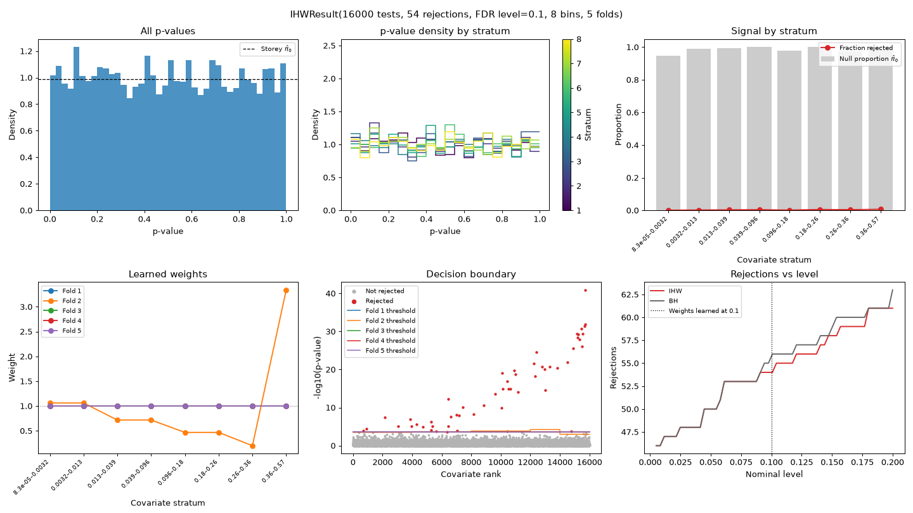

# pyIHW

`pyihw` is a Python implementation of Independent Hypothesis Weighting (IHW),
based on the Bioconductor R package [IHW](https://bioconductor.org/packages/IHW/).
It learns covariate-dependent hypothesis weights using cross-fitting, then
applies weighted Benjamini–Hochberg (FDR) or Bonferroni (FWER) adjustment.

The covariate must be independent of the p-value under the null hypothesis.
Choosing a covariate that violates this assumption can invalidate error-rate
control.

## Install

```bash
python -m pip install .
```

For diagnostic plots:

```bash
python -m pip install '.[plot]'
```

## Example

```python
import numpy as np
from scipy.stats import norm
from pyihw import ihw

rng = np.random.default_rng(42)
covariate = rng.uniform(0, 4, size=10_000)
is_signal = rng.binomial(1, 0.1, size=10_000)
z = rng.normal(is_signal * covariate)
pvalues = norm.sf(z)

result = ihw(pvalues, covariate, alpha=0.1, nbins=10, seed=1)
print(result.rejections())
adjusted_pvalues = result.adj_pvalues()
weights = result.weights()
```

`ihw` accepts numeric ordinal covariates or categorical covariates (for example,
a pandas `Categorical`/`Series` of strings). Numeric covariates are stratified
into approximately equal-sized bins. Missing p-values are retained in the
result with missing weights, adjusted p-values, and nullable rejection flags.
The main result accessors are `adj_pvalues`, `weights`, `thresholds`,
`pvalues`, `weighted_pvalues`, `covariates`, `groups_factor`,
`rejected_hypotheses`, `rejections`, and `to_dataframe`.

The implementation supports the core `ihw` options, regularization selection,
pre-specified folds, and incomplete p-value lists with `m_groups`.
`IHWResult.stratification_breaks()` returns the maximum covariate value in
each ordinal stratum, and `IHWResult.stratum_sizes()` returns the number of
observed p-values per stratum. The decision
boundary plot uses covariate values on its x-axis by default; pass
`x_axis="ranks"` to use ranks instead.

## Toy example notebook

[`examples/ihw_toy_example.py`](examples/ihw_toy_example.py) is a marimo
notebook. It simulates tests with a known truth, compares BH with IHW, walks
through the QC plots, and checks that an uninformative covariate does no harm:

```bash
uvx marimo edit --sandbox examples/ihw_toy_example.py
```

## QC plots

```python
from pyihw import qc_report

qc_report(result).savefig("ihw_qc.png")   # six-panel overview
result.plot("weights")                    # or "decisionboundary", "pvalues", "rejections", "qc"
```



See [docs/qc.md](docs/qc.md) for what each panel should look like.

## Use with pysceptre

`ihw_with_power` uses analytical power from `pysceptre.compute_power` as the
IHW covariate for a pysceptre discovery analysis:

```python
from pyihw import ihw_with_power

weighted = ihw_with_power(discovery, power, alpha=0.1, nbins=10)
weighted["ihw_rejected"]   # discoveries; also ihw_weight, ihw_adj_p_value
```

[docs/pysceptre.md](docs/pysceptre.md) covers the full workflow: computing
power, choosing a pre-specified cutoff, and the calibration-pair null check
that verifies the covariate assumption. A runnable end-to-end script is in
[`examples/pysceptre_ihw.py`](examples/pysceptre_ihw.py).

## Package layout

| module | contents |
| --- | --- |
| `fitting` | `ihw()`, the main entry point |
| `result` | `IHWResult` and its accessors |
| `stratification` | covariate binning (`groups_by_filter`) |
| `crossfit` | fold assignment and regularization (λ) selection |
| `grenander` | least concave majorant / Grenander estimator |
| `optimization` | linear program that turns per-stratum Grenander fits into weights |
| `multiple_testing` | BH / Bonferroni thresholds and weighted adjustment |
| `plots` | QC plots and `qc_report` |
| `adapters` | `ihw_formula`, `ihw_deseq_results` |
| `sceptre` | `ihw_with_power`, `calibration_cells_per_grna` |

## Parity with R

`tests/test_parity.py` compares against fixtures produced by Bioconductor IHW
1.40.0 (`tests/fixtures/ihw_r_results.json`). With identical folds and a
single λ, weights agree to about 1e-12 and rejections are identical.
Python's `seed` makes runs reproducible, but does not reproduce R's random
number stream. As a result, random fold assignment and internal λ
cross-validation can differ slightly between languages. Supply the same
explicit `folds` (and a single `lambdas` value) when comparing results across
the two implementations.

As in R, p-values at or below a tiny threshold are set to 0 before the
Grenander fit. R uses 1e-20; pyihw uses `1e-14` because SciPy's HiGHS solver
rejects the larger slopes that smaller p-values produce. These p-values are
rejected either way.

## Attribution

This is a Python reimplementation of the IHW method described by Ignatiadis,
Klaus, Zaugg, and Huber (2016), *Data-driven hypothesis weighting increases
detection power in genome-scale multiple testing*, Nature Methods 13, 577–580,
https://doi.org/10.1038/nmeth.3885. The upstream R package is maintained by
Nikos Ignatiadis and Wolfgang Huber and is distributed under the Artistic
License 2.0. This project is independently implemented and is not affiliated
with Bioconductor.
