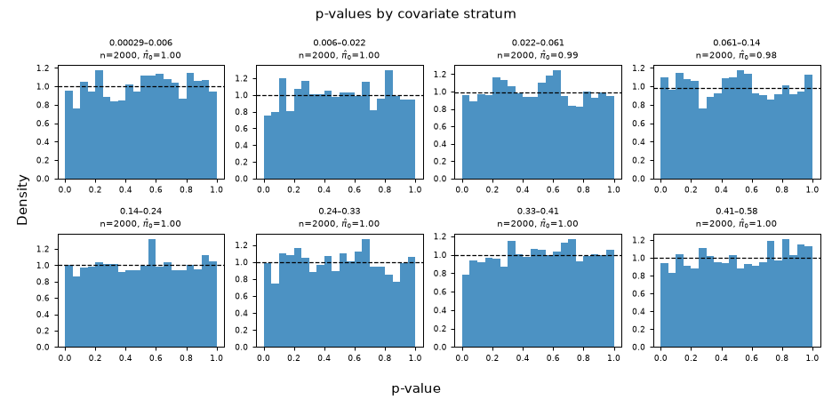
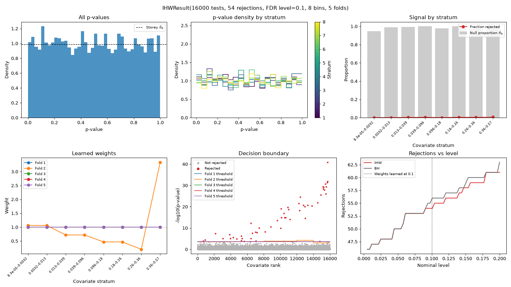

# Multiple-testing correction for a pysceptre screen

pysceptre returns one p-value per (gene, gRNA target) pair. Applying
Benjamini–Hochberg (BH) directly treats every pair the same, even though a
pair with a lowly expressed gene or few perturbed cells has little chance of
being detected. IHW uses the **analytical power** of each pair as a covariate
to up-weight pairs that can plausibly be discoveries, while keeping FDR
control.

A complete runnable version of this page is in
[`examples/pysceptre_ihw.py`](../examples/pysceptre_ihw.py).

## Workflow

```python
from pysceptre import compute_power, run_calibration_check, run_discovery_analysis
from pysceptre.analytical_power import (
    baseline_expression_stats_from_fits,
    cells_per_grna_from_assignments,
)
from pysceptre.pipeline.discovery import fit_all_genes
from pyihw import calibration_cells_per_grna, ihw_with_power, qc_report

ALPHA = 0.1

# 1. Discovery analysis, as usual.
discovery = run_discovery_analysis(
    response_matrix, gene_ids, covariate_matrix, grna_target_cells, pairs, seed=0
)

# 2. Analytical power for the same pairs.
fits = fit_all_genes(response_matrix, gene_ids, covariate_matrix)
baseline = baseline_expression_stats_from_fits(covariate_matrix, fits)
cells_per_grna = cells_per_grna_from_assignments(grna_target_data_frame, grna_cells)
power = compute_power(
    pairs, cells_per_grna, baseline,
    fold_change_mean=0.85, fold_change_sd=0.13,   # the effect you want to detect
    cutoff=ALPHA / len(pairs) / 2,                # fixed in advance, see below
    num_total_cells=n_cells,
)

# 3. IHW with power as the covariate.
weighted = ihw_with_power(discovery, power, alpha=ALPHA, nbins=8)
hits = weighted[weighted["ihw_rejected"].fillna(False)]

# 4. QC.
fit = weighted.attrs["ihw_result"]
qc_report(fit).savefig("ihw_qc.png")
```

`ihw_with_power` joins on `(response_id, grna_target)` and keeps every
discovery row. It adds these columns:

| column | meaning |
| --- | --- |
| `ihw_weight` | learned weight (weights average 1) |
| `ihw_weighted_p_value` | `p_value / ihw_weight` |
| `ihw_adj_p_value` | weighted-BH adjusted p-value |
| `ihw_rejected` | discovery at `alpha`; `<NA>` for untested pairs (missing `p_value`) |

Any extra keyword argument, such as `nbins`, `nfolds`, `lambdas`, or `seed`,
is passed to `pyihw.ihw`. The fitted `IHWResult` is stored in
`weighted.attrs["ihw_result"]`.

## Choosing the power inputs

* **`fold_change_mean` / `fold_change_sd`**: the effect size you care about.
  This is a scientific choice; IHW cannot infer it.
* **`cutoff`**: the p-value threshold used to compute power. Fix it in
  advance, for example as a Bonferroni-like `alpha / n_pairs`. Do **not**
  derive it from the discovery p-values (for example the BH cutoff of this
  run), because that makes the covariate depend on the p-values.
* **`nbins`**: aim for at least a few hundred pairs per bin. With too few
  pairs per bin, the weights become noisy across folds, which you can see in
  the weights panel of the QC report.

## Null check with calibration pairs

IHW controls the FDR only if the covariate is independent of the p-value under
the null. Power is computed from expression statistics of the same screen, so
check this empirically with negative-control pairs. Run the same pipeline on
calibration pairs; there should be (almost) no rejections, and every stratum's
p-value histogram should be flat:

```python
calibration = run_calibration_check(
    response_matrix, gene_ids, covariate_matrix, ntc_grna_cells,
    n_calibration_pairs=len(pairs), calibration_group_size=2, seed=0,
)
calibration_power = compute_power(
    calibration,
    calibration_cells_per_grna(calibration, ntc_grna_cells),  # splits "nt1&nt2" targets
    baseline,
    fold_change_mean=0.85, fold_change_sd=0.13,
    cutoff=ALPHA / len(pairs) / 2, num_total_cells=n_cells,
)
null_fit = ihw_with_power(calibration, calibration_power, alpha=ALPHA, nbins=8).attrs["ihw_result"]
print(null_fit.rejections())        # should be ~0
null_fit.plot("pvalues")            # every stratum should look uniform
```



If some strata are clearly not uniform, especially if low-power strata
are skewed toward 0 or 1, do not use power as an IHW covariate for this screen.
Fall back to BH.

## Reading the QC report



See [qc.md](qc.md) for a panel-by-panel explanation.
